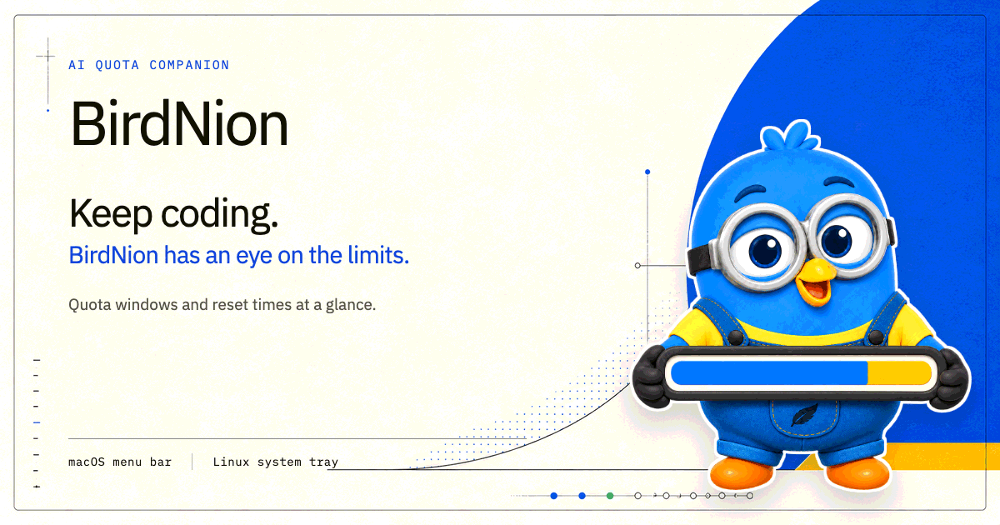
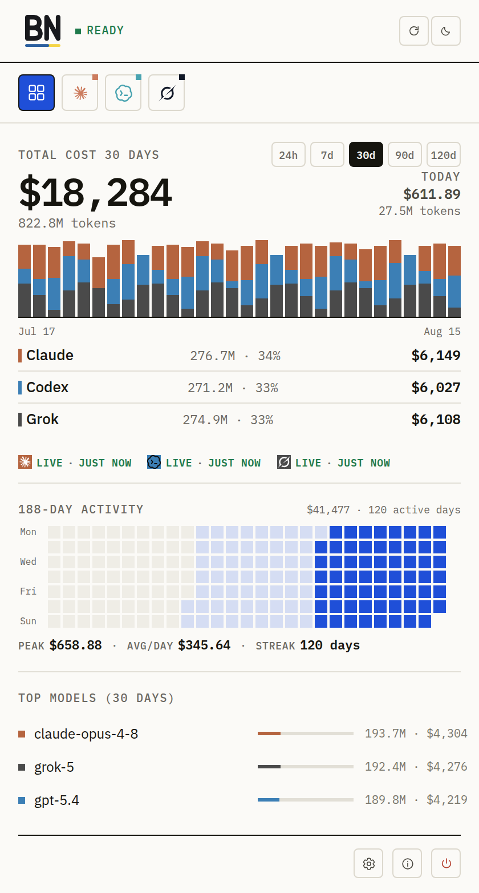
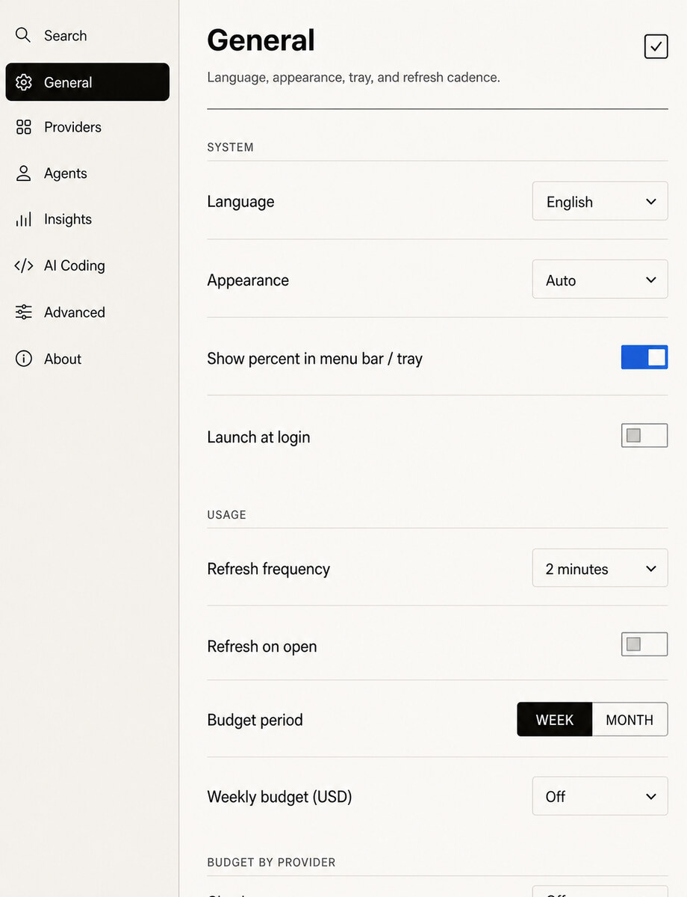

<div align="center">
  
</div>

# BirdNion - AI エージェントを、いつも予算内に。

> AI コーディングの利用枠もエージェントの設定も、macOS のメニューバーや Linux のシステムトレイに。

[English](README.md) · [Tiếng Việt](README.vi.md) · [中文](README.zh.md) · **日本語** · [한국어](README.ko.md) · [Español](README.es.md) · [Deutsch](README.de.md) · [Français](README.fr.md)


[](https://github.com/hapo-nghialuu/BirdNion/releases/latest)
[](https://github.com/hapo-nghialuu/BirdNion/releases/latest)
[](https://github.com/hapo-nghialuu/BirdNion/releases/latest)
[](https://github.com/hapo-nghialuu/homebrew-tap)
[](LICENSE)

38 のプロバイダーに対応。BirdNion は、macOS 14+ のメニューバーと Linux のトレイに常駐する小さなアプリです。AI コーディングの利用上限と各枠のリセット時期を見やすく表示し、コーディングエージェントごとのデータ取得方法を一か所で管理できます。Codex、Claude、MiniMax、OpenRouter、DeepSeek、z.ai、ElevenLabs、Deepgram、Groq、Grok、xAI、OpenAI、Ollama、GitHub Copilot、Kilo、Command Code、Xiaomi MiMo、Alibaba/Qwen、Cursor、Gemini、Kiro、OpenCode、OpenCode Go、Antigravity、AWS Bedrock、FreeModel、Devin、Hapo AI Hub に加え、JavaScript プラグインのプロバイダー（Aixy、Atlas Cloud、ClinePass、LiteLLM、Muse Code、Nous Portal、Raycast、Sakana AI、Venice、xKiro）をサポートしています。

macOS のネイティブアプリは SwiftUI/AppKit と、必要な部分に絞って同梱した `CodexBarCore` のサブセットを使用しています。Linux 版は `linux/` にあり、Tauri v2、Rust のコア、フレームワークを使わない TypeScript UI で構成されています。両プラットフォームで共通の XDG プロバイダー設定スキーマを使います。

## BirdNion を使う理由

- **リセットに合わせて計画。** プロバイダーごとの 5 時間・週間・月間の利用枠、クレジット、予算を、リセットまでのカウントダウンとともに確認できます。
- **支出とコストを確認。** Claude のローカル JSONL スキャン、週間利用分析、プライバシーに配慮したプロジェクトランキング、Claude Admin API のグラフ、Codex のクレジット、OpenRouter の残高、Bedrock の予算に加え、対応するプロバイダーではコストやクレジットのサマリーも確認できます。
- **エージェントのデータ取得元を設定。** 設定画面から、プロバイダーごとに OAuth、CLI、ブラウザーのクッキー、API キー、AWS 認証情報、ローカルアプリのファイル、プロバイダーのアプリを選べます。
- **状況を把握したまま切り替え。** macOS と Linux の両方で、Claude/Codex のカスタムプロファイル切り替え、Codex のクレジットリセット・自動プライミング、Codex、Copilot、Antigravity、FreeModel の複数アカウント操作に対応しています。
- **デスクトップはすっきり。** macOS ではプロバイダーの残り利用枠をパーセントでメニューバーに順番に表示できます。Linux ではプロバイダーのロゴとパーセントをトレイアイコン内に順番に表示します。
- **プライバシー優先。** BirdNion は既存のセッションと明示的な設定を再利用します。パスワードの保存や、範囲を限定しないディスクスキャンは行いません。

## インストール

### 動作要件

- macOS 14+（Sonoma）
- 公開されている `.deb`、`.rpm`、`.AppImage` パッケージには Linux x86_64 が必要です

### GitHub リリース

[GitHub リリース](https://github.com/hapo-nghialuu/BirdNion/releases)からビルド済みパッケージをダウンロードできます。

- `BirdNion-<version>.zip` - macOS ユニバーサルアプリ。Developer ID で署名し、Apple の公証を取得済みです。
- `BirdNion_<version>_amd64.deb` - Ubuntu/Debian パッケージ。
- `BirdNion-<version>-1.x86_64.rpm` - Fedora/RHEL パッケージ。
- `BirdNion_<version>_amd64.AppImage` - Linux 向けポータブルパッケージ。
- Homebrew の cask は SHA256 を使用します。
- 公証チケットをアプリに添付しているため、通常の「インターネットからダウンロードされた」アプリの確認後は、オフラインでも Gatekeeper でそのまま開けます。

### Homebrew で macOS にインストール

推奨のインストールコマンド：

```bash
brew install --cask hapo-nghialuu/tap/birdnion
```

完全修飾名のコマンドで `hapo-nghialuu/tap/birdnion` を明示的に指定するため、別途 `brew tap` を実行する必要はありません。

tap を追加してから短い名前でインストールする場合：

```bash
brew tap hapo-nghialuu/tap
brew trust --cask hapo-nghialuu/tap/birdnion
brew install --cask birdnion
```

または、tap 全体を信頼する場合：

```bash
brew trust hapo-nghialuu/tap
brew install --cask birdnion
```

通常のインストール方法として `HOMEBREW_NO_REQUIRE_TAP_TRUST=1` を使わないでください。これはユーザー側の環境設定による上書きであり、`Casks/birdnion.rb` 内に記述しても、Homebrew が cask を読み込む前の信頼確認を回避することはできません。

### macOS 版の更新

```bash
brew update && brew upgrade --cask birdnion
```

tap から最新の cask を取得するため、最初に `brew update` を実行してください（`&&` でつなぎます）。
`brew upgrade` だけではサードパーティーの tap は更新されず、古いバージョンを参照したまま
「インストール済み」と表示されます。

インストール済みのバージョンを確認：

```bash
brew list --cask --versions birdnion   # or: brew info --cask birdnion
```

### Linux

[最新リリース](https://github.com/hapo-nghialuu/BirdNion/releases/latest)から Linux 向けファイルを 1 つダウンロードします。

```bash
sudo apt install ./BirdNion_<version>_amd64.deb
# or
sudo dnf install ./BirdNion-<version>-1.x86_64.rpm
# or
chmod +x BirdNion_<version>_amd64.AppImage
./BirdNion_<version>_amd64.AppImage
```

### 初回起動

- macOS のメニューバーまたは Linux のシステムトレイから BirdNion を開きます。
- 設定 -> プロバイダーを開き、利用するものを有効にします。
- 利用するプロバイダーのデータ取得元をインストールするか、ログインします。取得元はプロバイダーに応じて、CLI、ブラウザーセッション、OAuth/デバイスフロー、API キー、ローカルアプリのファイル、クラウド認証情報などです。
- 必要に応じて、プロバイダーのアカウントラベル、メニューバー表示、更新間隔、クッキー取得元、リージョン、AWS 認証モード、Kilo の組織スコープ、Copilot のエンタープライズホスト、プロバイダー固有のメニューバー指標を設定します。

## エージェントの設定管理

BirdNion は、単なる利用枠ビューアーではなく、AI コーディングエージェント向けの軽量な設定コンソールを目指しています。

現在できること：

- プロバイダーの有効化、並び順、アカウントラベル、更新間隔、メニューバー表示の設定。
- OAuth、CLI、ブラウザーのクッキー、Admin API、ローカルアプリの状態から読み取れるプロバイダー向けのデータ取得元の選択。
- クッキーモード、手動クッキーヘッダー、MiniMax/z.ai/Alibaba のリージョン、AWS のキー・プロファイル・リージョン、Deepgram のプロジェクト ID、Kilo の組織スコープ、Copilot のエンタープライズホスト、メニューバー指標の選択など、プロバイダー固有の設定。
- Claude Code、Codex CLI、Gemini CLI、Kiro、Cursor、Antigravity など、自ら認証状態を管理するエージェントのローカルセッション検出。
- Claude Code の設定コンソール。プリセット・カスタムバックエンド、モデル階層、グローバルまたはプロジェクトのスコープ、JSON インポート、BirdNion が管理する環境変数キーの安全な削除に対応。
- Claude Code と Codex のカスタムプロファイル切り替え。実際の準備完了・情報の古さ・プロキシの健全性を確認し、検証に失敗した場合は有効化しません。
- Codex、GitHub Copilot、Antigravity、FreeModel の複数アカウントの検出と切り替え。FreeModel はブラウザーごとのセッションにも対応。

今後の方向性：

- Claude Code 以外のコーディングエージェントにもプロファイル管理を拡張。
- エージェントごとのログイン状態やデータ取得元の健全性を、より詳しく表示。
- ローカル設定パスと CLI が利用可能かを検証。
- Claude Code、Codex CLI、Gemini CLI、Kiro、今後対応するエージェント向けに初期設定のヒントを提供。
- 各エージェントの認証情報ストアには手を加えず、BirdNion の設定は BirdNion の設定レイヤーで管理。

## プロバイダー

- **Codex** - `~/.codex/auth.json` の OAuth API、API キーへのフォールバック、ローカルの `codex app-server` へのフォールバック、サービス状態、バージョン、クレジット、クレジットリセット、任意の OpenAI ウェブ追加情報、管理対象アカウントの切り替えに対応。
- **Claude** - OAuth API、ブラウザーのクッキー、CLI、Admin API に対応。5 時間・週間・Opus・Sonnet の利用枠、デイリールーティン、ローカルコストスキャン、ウェブ追加情報（追加利用の支出と前払いクレジット残高）、管理者向け 30 日間グラフを表示。Max プランでは利用倍率（Max 5x / Max 20x）も表示します。
- **MiniMax** - API トークン、環境変数のトークン、またはクッキーへのフォールバックで、コーディングプランの利用状況、プラン名、ポイント・サブスクリプション、グローバル/CN リージョンに対応。
- **OpenRouter** - API トークンで前払いクレジットと、任意のキー別支出上限を確認。
- **DeepSeek** - API トークンで USD/CNY 残高、有料分と付与分の内訳、残高不足の警告を表示。
- **z.ai** - API トークンとグローバル/CN リージョン設定で、利用上限と算出した残りのパーセントを表示。
- **ElevenLabs** - API キーで文字数クレジット、ボイス枠、プロフェッショナルボイス、プラン、サブスクリプション状態を確認。
- **Deepgram** - API キーと任意のプロジェクト ID で、利用状況のサマリーと全プロジェクトの集計モードに対応。
- **Groq** - API キーで、Prometheus に基づくリクエスト数、トークン数、キャッシュヒットの指標を取得。
- **Grok** - `~/.grok/auth.json`（`grok login`）から設定不要で接続。CLI の `x.ai/billing` RPC を使い、その後 Chrome のクッキーまたは認証用 Bearer トークン経由で grok.com の課金 gRPC-web を利用します。SuperGrok のアカウント情報とクレジット枠を表示。「すべて」タブでは `~/.grok/sessions/**/signals.json` からローカルコストを算出します（トークン総数 × モデル別の加重平均単価表）。
- **xAI** - 開発者プラットフォーム向けの Management API キーとチーム ID を使用（一般ユーザー向け Grok サブスクリプションとは別）。前払い残高とプラットフォームでの 30 日間の支出を表示。
- **OpenAI** - Platform Admin API（`OPENAI_ADMIN_KEY` / 設定）で組織の本日・7 日間・30 日間の支出を取得。任意のプロジェクト ID に対応し、ユーザー API キーでは従来のクレジット付与情報へフォールバックします。ChatGPT/Codex のサブスクリプションは対象外です（そちらは Codex を使用）。
- **Ollama** - ollama.com のクッキー（自動/手動）でクラウドのセッション・週間利用状況を取得。任意の `OLLAMA_API_KEY` で Cloud API へのアクセスを確認できます。
- **GitHub Copilot** - GitHub デバイスフローまたは PAT へのフォールバック、エンタープライズホスト、アカウントの追加・切り替え・削除の一元管理、プレミアム利用状況、ユーザー名、ウェブクッキー経由の追加予算情報に対応。
- **Kilo** - API トークンまたは CLI セッション、Kilo の組織スコープ、クレジット、自動チャージの詳細に対応。
- **Kiro** - CLI 経由の利用状況、クレジット・超過利用データ、9 種類のメニューバー表示モードに対応。
- **Command Code** - ブラウザーまたは手動入力のクッキーで、課金クレジットとプラン一覧を取得。
- **Xiaomi MiMo** - ブラウザーのクッキーで、残高、トークンプランの詳細、利用状況を取得。
- **Alibaba/Qwen** - ブラウザーのクッキーと国際/CN リージョン設定で、コーディングプランとトークンプランの利用枠を取得。
- **Cursor** - Cursor の `state.vscdb` を優先し、ブラウザーのクッキーにフォールバック。利用状況のサマリー、アカウント情報、リクエスト利用量を表示。
- **Gemini** - `~/.gemini/oauth_creds.json` の Gemini CLI OAuth 認証情報で、Cloud Code Assist の階層別利用枠を取得。
- **OpenCode** - ブラウザーのクッキーで、ローリング・週間の利用状況とサブスクリプション更新情報を取得。
- **OpenCode Go** - ブラウザーのクッキーと Go ワークスペースページで、ローリング・週間・月間の利用状況と Zen 残高を取得。
- **Antigravity** - ローカルプロセス・CLI の検出と Google OAuth アカウントストアで、利用枠とアカウントに一致するデータを取得。
- **AWS Bedrock** - AWS アクセスキーまたは名前付きプロファイル、リージョン、予算項目、CloudWatch/コストの利用状況に対応。
- **FreeModel** - `freemodel.dev` のブラウザーセッションから、5 時間・週間のドル建て予算を取得。ブラウザーごとのアカウント切り替えと、管理対象クッキーにも対応。
- **Devin** - `app.devin.ai/api/<org>/billing/quota/usage` から日次・週次の利用枠を取得。Chrome の localStorage からブラウザーのセッショントークンと組織を自動インポートするか、Bearer トークンを手動入力し、任意で組織（スラッグまたは内部の `org-...` ID）を指定できます。

既存の `QuotaProvider` モデルに適合するプロバイダーの追加を歓迎します。

## マスコット、アイコン、スクリーンショット

macOS のメニューバーアイコンは、標準では BirdNion の小鳥です。「メニューバーにパーセントを表示」を有効にすると、利用中のプロバイダーの残り利用枠を、各プロバイダーのロゴとともに順番に表示します。Linux では、切り替わるプロバイダーのロゴとパーセントをトレイアイコン内に直接表示します。

<div align="center">
  
  <br />
  <strong>利用枠を見守る相棒 BirdNion</strong>
</div>

<br />

<div align="center">
  
  <br />
  <strong>BirdNion のアプリアイコン</strong>
</div>

<br />

<div align="center">
  
  <br />
  <strong>利用状況とコストの概要</strong>
</div>

<br />

<div align="center">
  
  <br />
  <strong>設定画面 · 現在の Linux 版の設定実装をもとにしたイラスト</strong>
</div>

## 機能

- macOS のメニューバーや Linux のトレイアイコンに、プロバイダーの値を任意で順番に表示。プロバイダーの切り替えと、各プラットフォームに適した並べ替え操作に対応。
- プロバイダー別の利用量メーターと、リセットまでのカウントダウン。
- セットアップガイドは、修正可能なプロバイダーのエラーを該当する設定項目に案内します。先に設定を保存し、実際のセルフテストに成功してから「接続中」にします。
- ポップオーバーのヘッダーにある小さなアクションセンターバッジから、現在の設定・接続の問題に関する設定を開けます。解決した項目は自動的に消え、問題履歴は保存しません。
- 段階的な更新：各プロバイダーは、データ取得が完了し次第、結果を表示します。
- 更新中も、最後に取得したデータを表示し続けます。
- OAuth、CLI、ウェブクッキー、Admin API、ローカルアプリの状態、固定キーから、プロバイダーのデータ取得元を選択。
- プロバイダーごとの更新間隔とメニューバー表示。
- クッキーを使うプロバイダー向けに、自動・手動・オフのモードを備えたクッキー取得元の選択。
- 17 種類のエージェント — Claude、Codex、Grok、Kiro、Oh My Pi、Pi、Devin、OpenCode、Gemini CLI、Copilot CLI、Antigravity、Cursor、Amp、Droid、Kimi、Qwen Code、Goose — のローカルコストグラフと、最大記録値を保持する永続的な履歴。保存済みの棒グラフをすぐに表示し、対象を絞った最新スキャンで直近の日付を更新します。
- 「すべて」タブのコンパクトな分析ハイライトから、設定 -> 分析を開き、7 日間の比較と 7/30/90 日間のプロジェクトランキングを確認できます。Claude、Codex、Grok はローカルセッションのメタデータから、プライバシーに配慮したプロジェクト識別情報を生成します。帰属先を特定できない残りの利用量だけが、明示的に `Unknown` として残ります。
- 有効にした場合の Claude Admin API の 30 日間グラフと、Codex ウェブダッシュボードの追加情報。
- Kiro のカスタム表示値：残りクレジット、パーセント、使用量/合計、超過利用モード。
- しきい値を設定できる、利用枠とプロバイダー障害の通知。
- アクセス権限を制限した XDG 設定ファイル。

## 設定と保存先

| データ | 保存先 |
|---|---|
| プロバイダー一覧、有効化フラグ、API キー、リージョン、予算、プロジェクト ID、ベース URL、アカウントラベル | `~/.config/birdnion/settings.json` |
| 設定の上書き | `$BIRDNION_CONFIG` |
| XDG による上書き | `$XDG_CONFIG_HOME/birdnion/settings.json` |
| 旧設定 | `~/.birdnion/settings.json` |
| Codex OAuth | `~/.codex/auth.json`、Codex CLI が管理 |
| Claude OAuth | macOS の Keychain 項目 `Claude Code-credentials`、Linux の `~/.claude/.credentials.json`。どちらも Claude Code/CLI が管理 |
| Gemini OAuth | `~/.gemini/oauth_creds.json` |
| Cursor セッション | macOS: `~/Library/Application Support/Cursor/User/globalStorage/state.vscdb`; Linux: `~/.config/Cursor/User/globalStorage/state.vscdb` |
| Antigravity OAuth アカウント | `~/.config/birdnion/antigravity-oauth.json` |
| Copilot OAuth アカウント | `~/.config/birdnion/copilot-accounts.json` |
| FreeModel 管理対象アカウント | macOS: `~/Library/Application Support/BirdNion/freemodel-accounts.json`; Linux: `~/.config/birdnion/freemodel-accounts.json` |
| 日別コスト履歴（「すべて」タブ） | `~/.config/birdnion/cost-history.json`（設定ファイルと同じディレクトリ。最大記録値を保持してマージするため、エージェントのセッションを削除しても過去の棒グラフは残ります） |
| プロジェクト別コスト履歴（分析） | `~/.config/birdnion/project-cost-history.json`（独立した任意のストア。SHA-256 のプロジェクトキー・撤回 ID、安全なベース名、集計値を上限とする最大記録値のマージ、`0600`） |
| macOS の UI 設定 | `UserDefaults`（`showPercentInMenuBar`、表示、更新、データ取得元、表示内容の設定） |
| Linux の UI 設定 | Tauri WebView の `localStorage`。プロバイダーのクッキー・表示・更新の項目は `settings.json` に保持 |

設定パスの優先順位：

1. `$BIRDNION_CONFIG`
2. `$XDG_CONFIG_HOME/birdnion/settings.json`
3. `~/.config/birdnion/settings.json`
4. `~/.birdnion/settings.json`

設定ファイルはアトミックに書き込まれ、権限は `0600` に設定されます。

## プライバシーについて

BirdNion は、範囲を限定しないファイルシステムの巡回を行いません。関連するプロバイダーやデータ取得元が有効な場合にのみ、文書化された場所を読み取ります。対象はプロバイダーの設定ファイル、CLI 認証ファイル、ブラウザーのクッキーストア、ローカル IDE データベース、ローカルエージェントのセッションログです。プロバイダーのトークンは、アクセス権限を制限した BirdNion の設定ファイル内に保存します。OAuth、Keychain、CLI のセッションファイルは、引き続き元のツールが管理します。

パスワードは保存しません。ブラウザーのクッキーは、ユーザーがクッキーを使うデータ取得元を選択した場合にのみ再利用します。分析機能はプロジェクトのフルパスを永続化しません。Claude は安定したセッションディレクトリトークンを、Codex は検証済みの絶対パス `cwd` を、Grok はエンコードされたセッションディレクトリトークンをハッシュ化します。検証済みパスは、無害化されたベース名ラベルの改善にのみ使用できます。UI とコピー用サマリーには、その安全なラベル、または帰属不明の残余分を示す明示的な `Unknown` 区分だけが渡されます。

## プラットフォーム別の注意事項

### macOS の権限

- **フルディスクアクセス** - アプリの基本機能には不要です。ブラウザーのクッキーを使うプロバイダーでは、ブラウザーやクッキーストアによって、追加の macOS アクセス権限が必要になる場合があります。
- **Keychain アクセス** - Claude OAuth は、Claude Code/CLI が管理する `Claude Code-credentials` 項目を読み取る場合があります。ブラウザーのクッキーをインポートする際にも、ブラウザーの Safe Storage の Keychain 確認が表示される場合があります。
- **ファイルとフォルダーの確認** - ローカルプロバイダーの検出時に、内部の CLI やヘルパーが保護された場所にアクセスすると、macOS の確認が表示される場合があります。
- **BirdNion がバックグラウンドで要求しない権限** - 画面収録とアクセシビリティの権限は要求しません。

### Linux

- ブラウザーのクッキーを使うプロバイダーには、対応する Chrome/Chromium/Brave/Edge/Firefox のプロファイルが必要で、デスクトップのキーリングに依存する場合があります。
- Linux のデスクトップ環境では、トレイアイコンの横にテキストを表示する共通の仕組みがないため、切り替わるプロバイダーのロゴとパーセントをシステムトレイのアイコン内に直接描画します。
- Linux ではグローバルホットキーは有効になっていません。アプリのウィンドウと設定画面を使用してください。

## ドキュメント

- [docs/build.md](docs/build.md) - ビルド、署名、トラブルシューティング。
- [docs/system-architecture.md](docs/system-architecture.md) - システム構成と過去の意思決定の記録。
- [docs/development-roadmap.md](docs/development-roadmap.md) - 過去のロードマップ。
- [docs/provider-parity/README.md](docs/provider-parity/README.md) - BirdNion と CodexBar の機能同等性の監査。
- [docs/linux-parity-matrix.md](docs/linux-parity-matrix.md) - macOS/Linux の機能同等性。
- [linux/README.md](linux/README.md) - Linux での開発、パッケージング、プラットフォームの注意事項。

## 開発を始める

- リポジトリをクローンします。macOS では `BirdNion.xcodeproj` を開き、Tauri の開発では `linux/` で作業します。
- 一度起動してから、設定 -> プロバイダーでプロバイダーの有効・無効を切り替えます。
- 利用するプロバイダーのデータ取得元をインストールするか、ログインします。CLI、ブラウザーのクッキー、OAuth/デバイスフロー、API キー、プロバイダーのアプリ、ローカル設定ファイルに対応します。
- 必要に応じて、Codex ダッシュボードの追加情報用に OpenAI のクッキーを設定し、Claude のデータ取得元を OAuth/ウェブ/CLI/Admin API に振り分けます。

## ソースからビルド

### macOS

macOS 14+ と、プロジェクトのスキームで Swift をサポートする Xcode が必要です。

```bash
xcodebuild test -project BirdNion.xcodeproj -scheme BirdNion \
  -configuration Debug -destination 'platform=macOS'

xcodebuild build -project BirdNion.xcodeproj -scheme BirdNion \
  -configuration Release -destination 'platform=macOS'
```

BirdNion は、必要な部分に絞った `CodexBarCore` パッケージを `Vendor/CodexBar` に同梱しています。外部の `~/Desktop/CodexBar` チェックアウトは不要です。

### Linux

開発とテストは、macOS または Linux の `linux/` から実行できます。Linux ネイティブパッケージは、WebKitGTK/AppIndicator の依存関係をインストールした Linux 上でビルドする必要があります。

```bash
cd linux
npm ci
npm test
npm run build
cargo test --manifest-path src-tauri/Cargo.toml

# On Linux: build .deb, .rpm, and AppImage bundles
npm run tauri build
```

## 謝辞

[CodexBar](https://github.com/steipete/CodexBar)、特にダッシュボードを開かずに AI コーディングのあらゆる利用上限を確認できるという発想に着想を得ています。BirdNion は、クロスプラットフォームのプロバイダー対応、設定、配布の仕組みを独自に管理しています。

## ライセンス

MIT.
